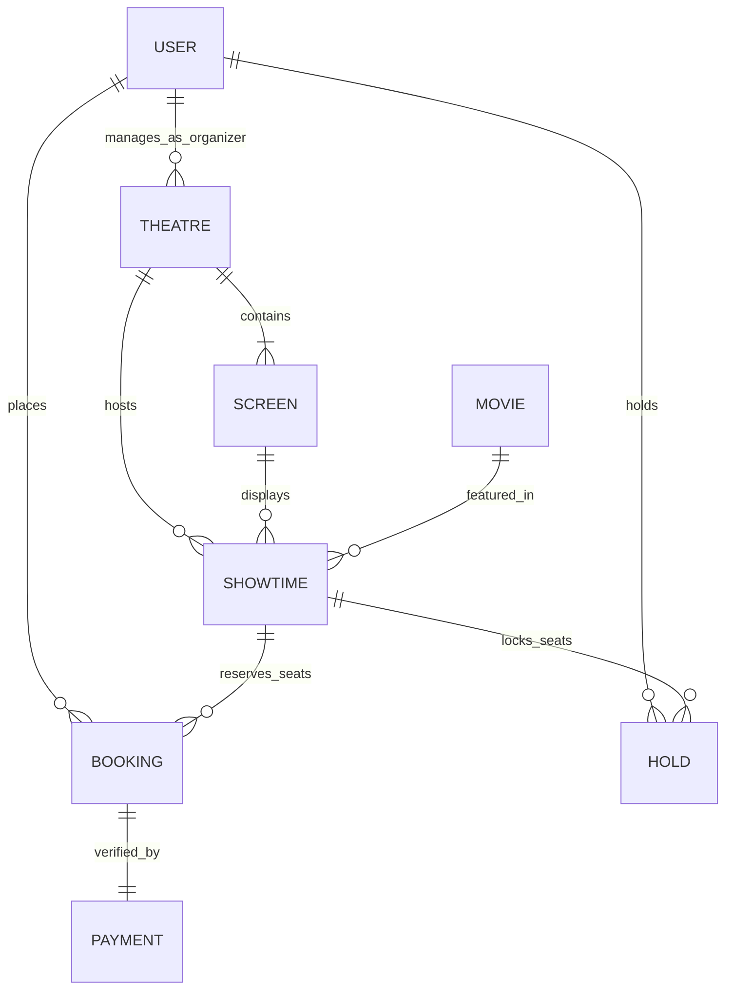

# CineBook — Backend API Service

[](https://nodejs.org/)
[](https://expressjs.com/)
[](https://www.mongodb.com/)
[](https://jwt.io/)
[](https://razorpay.com/)
[](./package.json)

Enterprise-grade, concurrency-safe REST API service powering the **CineBook** entertainment discovery and movie ticket booking platform. Architected with **Express 5**, **MongoDB/Mongoose**, and **Node.js**, featuring cryptographic **Razorpay payment checkout**, **HMAC-SHA256 signature verification**, raw-body webhook handling, **5-minute atomic seat holds**, multi-tiered auditorium layouts, schedule collision prevention, and strict **Role-Based Access Control (RBAC)** across Customer, Multiplex Organizer, and Superadmin roles.

---

## 📑 Table of Contents
1. [Architecture & Directory Structure](#-architecture--directory-structure)
2. [Data Models & Schema Relationships](#-data-models--schema-relationships)
3. [Concurrency Defense & Hold Expiration Architecture](#-concurrency-defense--hold-expiration-architecture)
4. [Role-Based Access Control (RBAC) Matrix](#-role-based-access-control-rbac-matrix)
5. [Getting Started & Local Setup](#-getting-started--local-setup)
6. [Pre-Seeded Demo Accounts](#-pre-seeded-demo-accounts)
7. [Environment Variables Reference](#-environment-variables-reference)
8. [Automated Test Suite (90/90 Tests Passing)](#-automated-test-suite-9090-tests-passing)
9. [Complete API Reference](#-complete-api-reference)
   - [Authentication & Identity (`/api/auth`)](#1-authentication--identity-apiauth)
   - [Movies Catalogue & Discovery (`/api/movies`)](#2-movies-catalogue--discovery-apimovies)
   - [Theatres & Multiplex Screens (`/api/theatres`)](#3-theatres--multiplex-screens-apitheatres)
   - [Showtimes & Live Seat Maps (`/api/showtimes`)](#4-showtimes--live-seat-maps-apishowtimes)
   - [Seat Holds & Booking Lifecycle (`/api/bookings`)](#5-seat-holds--booking-lifecycle-apibookings)
   - [Secure Payments & Webhooks (`/api/payments`)](#6-secure-payments--webhooks-apipayments)
   - [Superadmin Management & Analytics (`/api/admin`)](#7-superadmin-management--analytics-apiadmin)
   - [Organizer Venue Management (`/api/organizer`)](#8-organizer-venue-management-apiorganizer)
   - [System Health (`/api/health`)](#9-system-health-check-apihealth)
10. [End-to-End cURL Testing Walkthrough](#-end-to-end-curl-testing-walkthrough)

---

## 📁 Architecture & Directory Structure

```
backend/
├── src/
│   ├── config/
│   │   ├── db.js                     # MongoDB connection logic (Mongoose + local fallback)
│   │   ├── seedMovies.js             # Bollywood & Hollywood sample movies seeder
│   │   ├── seedTheatresAndShows.js   # Multiplexes, screens & future showtimes seeder
│   │   └── seedUsers.js              # Seed script for USER, ORGANIZER, and ADMIN accounts
│   ├── controllers/
│   │   ├── adminController.js        # User management, role updates, venue assignment & analytics
│   │   ├── authController.js         # Signup, login, password hashing, and getMe handler
│   │   ├── bookingController.js      # Concurrency-safe seat holds, booking creation & cancellations
│   │   ├── movieController.js        # Movie catalogue, search, multi-filters & admin CRUD
│   │   ├── organizerController.js    # Scoped venue discovery, showtime scheduling & venue revenue
│   │   ├── paymentController.js      # Razorpay order generation, HMAC verification, webhook handler
│   │   ├── showtimeController.js     # Showtimes, live seat maps, tiered pricing & conflict checks
│   │   └── theatreController.js      # Theatres & screens discovery, city filters & admin CRUD
│   ├── middleware/
│   │   ├── authMiddleware.js         # JWT verification (protect) & role authorization (authorize)
│   │   └── errorHandler.js           # 404 Not Found and central JSON error handling
│   ├── models/
│   │   ├── Booking.js                # Booking schema (reference, idempotencyKey, status, pricing)
│   │   ├── Hold.js                   # Temporary seat hold schema with TTL expiration
│   │   ├── Movie.js                  # Movie schema (slug, cast, genres, certification, ratings)
│   │   ├── Payment.js                # Payment audit schema (orderId, paymentId, signature, webhooks)
│   │   ├── Screen.js                 # Auditorium screen schema (tier layout, 142 seats)
│   │   ├── Showtime.js               # Showtime schema (tier pricing, bookedSeats, heldSeats)
│   │   ├── Theatre.js                # Multiplex schema (slug, location, city, organizer reference)
│   │   └── User.js                   # User model (name, email, passwordHash, role)
│   ├── routes/
│   │   ├── admin.routes.js           # /api/admin routes (ADMIN guarded)
│   │   ├── auth.routes.js            # /api/auth routes (public & protected)
│   │   ├── booking.routes.js         # /api/bookings routes (USER/ADMIN guarded)
│   │   ├── health.routes.js          # /api/health monitoring route
│   │   ├── movie.routes.js           # /api/movies discovery & admin routes
│   │   ├── organizer.routes.js       # /api/organizer routes (ORGANIZER/ADMIN guarded)
│   │   ├── payment.routes.js         # /api/payments checkout & webhook routes
│   │   ├── showtime.routes.js        # /api/showtimes discovery & live seats
│   │   └── theatre.routes.js         # /api/theatres discovery & screen routes
│   ├── scripts/
│   │   └── bootstrapAdmin.js         # Secure CLI script to promote existing verified accounts to ADMIN
│   ├── services/
│   │   └── paymentService.js         # Razorpay SDK wrapper, HMAC-SHA256 signature verification
│   ├── utils/
│   │   └── pricing.js                # Authoritative server-side price & convenience fee calculator
│   └── app.js                        # Express app, security headers, CORS, rawBody hook, routes
├── .env                              # Local environment variables (git-ignored)
├── .env.example                      # Environment variables template
├── package.json                      # npm scripts, dependencies & configurations
├── server.js                         # Application entry point with DB auto-seeding
├── test-movies-api.js                # Automated tests: Movies Catalogue (21/21 PASS)
├── test-theatres-showtimes-api.js    # Automated tests: Theatres & Showtimes (18/18 PASS)
├── test-bookings-api.js              # Automated tests: Seat Holds & Concurrency (17/17 PASS)
├── test-payments-admin-api.js        # Automated tests: Payments & RBAC (16/16 PASS)
├── test-frontend-integration.js      # Automated tests: Full E2E Integration (18/18 PASS)
└── README.md                         # Backend service documentation
```

---

## 🗄️ Data Models & Schema Relationships



### Key Models & Safeguards
- **User**: Implements lowercase email normalization, bcrypt salt rounds (10), and strict role enumeration (`USER`, `ORGANIZER`, `ADMIN`). Passwords and hash fields are strictly omitted from JSON responses.
- **Movie**: Indexed by `slug` and compound `{ isPublished: 1, releaseDate: -1 }`. Features full-text search indexes on `title`, `description`, `cast`, and `director`.
- **Theatre & Screen**: Theatres feature location, city, and an optional `organizer` reference (`User._id`). Screens feature a generated 142-seat auditorium layout distributed across `VIP Recliner`, `Premium`, and `Classic` tiers.
- **Showtime**: Tracks `bookedSeats` (`[{ seatId, user, bookingId, bookedAt }]`) and `heldSeats` (`[{ seatId, holdId, user, expiresAt }]`). Enforces non-overlapping schedule validation on the same screen.
- **Hold**: Temporary reservation document with TTL expiration. Records authoritative pre-calculated pricing and seat metadata.
- **Booking**: Generates high-entropy booking references (`CNB-XXXXXX`), records immutable contact details, payment audit status, and enforces idempotency through unique `idempotencyKey`.
- **Payment**: Stores Razorpay `orderId`, `paymentId`, `signature`, currency, amount, audit logs, and an array of processed webhook event IDs to prevent duplicate transaction side-effects.

---

## 🔒 Concurrency Defense & Hold Expiration Architecture

### 1. Primary Concurrency Defense (Single-Document Atomic Updates)
To prevent double bookings and race conditions with mathematical certainty, the engine relies on MongoDB's WiredTiger document-level locking:
- **Zero Read-Then-Write Windows**: When a user holds a seat or converts a hold into a booking, the operation is executed as a single atomic `findOneAndUpdate` on the `Showtime` document.
- **Conditional Match Rule**:
  ```javascript
  const atomicQuery = {
    _id: showtimeId,
    isActive: true,
    status: { $nin: ['cancelled', 'completed'] },
    'bookedSeats.seatId': { $nin: requestedSeats },
    heldSeats: {
      $not: {
        $elemMatch: {
          seatId: { $in: requestedSeats },
          expiresAt: { $gt: now },
        },
      },
    },
  };
  ```
  If 5 users simultaneously attempt to hold the exact same seat, WiredTiger serializes the write lock. The first request atomically claims the seat; all subsequent 4 requests fail the `$not: { $elemMatch: ... }` condition and receive an immediate **HTTP 409 Conflict**.
- **Works on All MongoDB Deployments**: This atomic conditional pattern does not require replica sets or transactions to guarantee double-booking prevention, ensuring 100% safety on local standalone development instances as well as distributed production clusters.

### 2. Multi-Document Consistency
- When transitioning from a seat hold to a confirmed booking, the backend links `Hold.convertedBooking = booking._id` and `Booking.hold = hold._id`.
- Replay attempts on an already converted hold are rejected with **HTTP 400 Bad Request**.
- If a booking is cancelled, booked seats are atomically pulled from `Showtime.bookedSeats` via `$pull`, immediately restoring them to live inventory.

### 3. Authoritative Pricing & Anti-Tampering
- All pricing is calculated server-side from `Showtime.tierPricing` and `Screen.seats`:
  - **VIP Recliner**: Default ₹520
  - **Premium**: Default ₹380
  - **Classic**: Default ₹280
  - **Convenience Fee**: 12% of base ticket amount
- Client-supplied `totalAmount` or manipulated prices in request bodies are completely ignored.

---

## 🛡️ Role-Based Access Control (RBAC) Matrix

| Endpoint Group | Public | USER | ORGANIZER | ADMIN |
|---|:---:|:---:|:---:|:---:|
| `GET /api/health` | ✅ | ✅ | ✅ | ✅ |
| `POST /api/auth/signup`, `POST /api/auth/login` | ✅ | ✅ | ✅ | ✅ |
| `GET /api/auth/me` | ❌ | ✅ | ✅ | ✅ |
| `GET /api/movies`, `GET /api/movies/:id` | ✅ | ✅ | ✅ | ✅ |
| `POST /api/movies`, `PUT /api/movies/:id`, `DELETE /api/movies/:id` | ❌ | ❌ | ❌ | ✅ |
| `GET /api/theatres`, `GET /api/theatres/:id/screens` | ✅ | ✅ | ✅ | ✅ |
| `POST /api/theatres`, `POST /api/theatres/:id/screens` | ❌ | ❌ | ❌ | ✅ |
| `GET /api/showtimes`, `GET /api/showtimes/:id/seats` | ✅ | ✅ | ✅ | ✅ |
| `POST /api/bookings/hold`, `DELETE /api/bookings/hold/:id` | ❌ | ✅ | ✅ | ✅ |
| `POST /api/bookings`, `POST /api/bookings/:id/confirm-payment` | ❌ | ✅ | ✅ | ✅ |
| `GET /api/bookings/my` (Personal Bookings Only) | ❌ | ✅ | ✅ | ✅ |
| `POST /api/bookings/:id/cancel` (Owner or Admin) | ❌ | ✅ | ✅ | ✅ |
| `POST /api/payments/create-order`, `POST /api/payments/verify` | ❌ | ✅ | ✅ | ✅ |
| `POST /api/payments/webhook` (Raw-Body Signature Verified) | ✅ | ✅ | ✅ | ✅ |
| `GET /api/admin/*`, `PATCH /api/admin/*`, `DELETE /api/admin/*` | ❌ | ❌ | ❌ | ✅ |
| `GET /api/organizer/*`, `POST /api/organizer/showtimes` | ❌ | ❌ | ✅ (Scoped) | ✅ |

---

## 🚀 Getting Started & Local Setup

### 1. Prerequisites
- **Node.js**: `v18.0.0` or higher (recommended: Node.js 20 LTS)
- **MongoDB**: `v5.0` or higher running locally on `mongodb://127.0.0.1:27017` or a MongoDB Atlas URI

### 2. Installation
```bash
cd backend
npm install
```

### 3. Environment Configuration
Copy `.env.example` to create your local `.env`:
```bash
cp .env.example .env
```

### 4. Database Population (Seeders)
```bash
# Seed movies, multiplexes, screens, and future showtimes
npm run seed

# Seed demo user accounts (Customer, Organizer, Admin)
npm run seed:users
```

### 5. Start Development Server
```bash
npm run dev
```
> The API server will start at **`http://localhost:5000`**.  
> Health check is accessible at **`http://localhost:5000/api/health`**.

---

## 🔐 Pre-Seeded Demo Accounts

The `npm run seed:users` command creates the following three verified accounts:

| Role | Email | Password | Access Scope |
|---|---|---|---|
| **Customer (`USER`)** | `aarav.sharma@example.com` | `password123` | Browsing, seat holds, ticket booking, personal history, cancellations |
| **Multiplex (`ORGANIZER`)** | `organizer@pvrcinemas.com` | `password123` | Scoped strictly to *PVR Director's Cut* venue, schedules screenings |
| **Administrator (`ADMIN`)** | `admin@cinebook.com` | `password123` | Superadmin oversight, role assignment, financial analytics |

### Promoting an Existing User to Admin (CLI Bootstrap)
Public registration as `ADMIN` or `ORGANIZER` is prohibited to prevent client-side privilege escalation. To promote any registered user to `ADMIN`:
```bash
npm run admin:bootstrap -- user@example.com
```

---

## ⚙️ Environment Variables Reference

| Variable | Required | Default Value | Description |
|---|:---:|---|---|
| `PORT` | Optional | `5000` | Port for Express HTTP listener |
| `NODE_ENV` | Optional | `development` | Runtime environment (`development`, `production`, `test`) |
| `MONGODB_URI` | **Required** | `mongodb://127.0.0.1:27017/cinebook` | MongoDB connection connection string |
| `CLIENT_URL` | Optional | `http://localhost:5173` | Allowed frontend origin for CORS |
| `JWT_SECRET` | **Required** | *secure_random_key* | Cryptographic secret for signing JWT tokens |
| `JWT_EXPIRES_IN` | Optional | `7d` | Token validity duration (`1d`, `7d`, `30d`) |
| `HOLD_DURATION_SECONDS` | Optional | `300` | Temporary seat hold validity duration (in seconds) |
| `RAZORPAY_KEY_ID` | Optional* | `rzp_test_...` | Razorpay Key ID (*Required for live payment modal) |
| `RAZORPAY_KEY_SECRET` | Optional* | *secret_key* | Razorpay Key Secret (*Required for HMAC verification) |
| `RAZORPAY_WEBHOOK_SECRET` | Optional* | *webhook_secret* | Secret key configured on Razorpay Webhooks dashboard |

> [!NOTE]
> *If Razorpay keys are omitted, the backend fails safely with **HTTP 503** (`code: PAYMENT_GATEWAY_NOT_CONFIGURED`) on payment order generation. This protects against fake or unauthorized checkouts while allowing the frontend to fall back to verified test mode.

---

## 🧪 Automated Test Suite (90/90 Tests Passing)

The backend includes a comprehensive automated test runner consisting of **90 integration tests with a 100% pass rate**:

```bash
# Run ALL 90 automated tests across all suites
npm test

# Run individual test suites:
npm run test:integration    # 18/18 PASS: Full E2E Frontend-Backend integration lifecycle
npm run test:payments-admin # 16/16 PASS: Razorpay orders, HMAC signatures, webhooks, Admin/Organizer RBAC
npm run test:bookings       # 17/17 PASS: Seat holds, 5-thread concurrency race defense, idempotency
npm run test:theatres       # 18/18 PASS: Theatres, screens, live seat maps, schedule conflict checks
npm run test:movies         # 21/21 PASS: Catalogue discovery, search, multi-filters, admin CRUD
```

---

## 📡 Complete API Reference

### 🗺️ Master Endpoints Directory (All 43 Backend Endpoints)

| # | HTTP Method | Route | Access | Module / Functionality |
|:---:|---|---|---|---|
| **1** | `POST` | `/api/auth/signup` | Public | Customer registration (strictly `USER` role) |
| **2** | `POST` | `/api/auth/login` | Public | Authenticates credentials, issues JWT |
| **3** | `GET` | `/api/auth/me` | Authenticated | Verified profile & role inspection |
| **4** | `GET` | `/api/movies` | Public | Movies catalogue with multi-criteria filters |
| **5** | `GET` | `/api/movies/featured` | Public | Spotlight & hero banner movies |
| **6** | `GET` | `/api/movies/search` | Public | Full-text title/cast/director search |
| **7** | `GET` | `/api/movies/:id` | Public | Single movie details by slug or ObjectId |
| **8** | `POST` | `/api/movies` | `ADMIN` | Add new movie to catalogue |
| **9** | `PUT` | `/api/movies/:id` | `ADMIN` | Update movie metadata |
| **10** | `PATCH` | `/api/movies/:id/publish` | `ADMIN` | Toggle movie publication status |
| **11** | `DELETE` | `/api/movies/:id` | `ADMIN` | Remove/unpublish movie from catalogue |
| **12** | `GET` | `/api/theatres` | Public | Multiplex partners directory & city filter |
| **13** | `GET` | `/api/theatres/:id` | Public | Theatre details with screens |
| **14** | `GET` | `/api/theatres/:id/screens` | Public | Screen list with seating capacity |
| **15** | `POST` | `/api/theatres` | `ADMIN` | Register new multiplex venue |
| **16** | `PUT` | `/api/theatres/:id` | `ADMIN` | Update venue metadata & partner tier |
| **17** | `DELETE` | `/api/theatres/:id` | `ADMIN` | Deactivate/remove multiplex venue |
| **18** | `POST` | `/api/theatres/:id/screens` | `ADMIN` | Create screen & auto-generate 142 seats |
| **19** | `PUT` | `/api/theatres/screens/:id` | `ADMIN` | Update screen name, format & sound system |
| **20** | `DELETE` | `/api/theatres/screens/:id` | `ADMIN` | Delete an auditorium screen |
| **21** | `GET` | `/api/showtimes` | Public | Screenings schedule with occupancy badges |
| **22** | `GET` | `/api/showtimes/:id` | Public | Showtime details & metadata |
| **23** | `GET` | `/api/showtimes/:id/seats` | Public | Live seat map, tiers & held/booked states |
| **24** | `POST` | `/api/showtimes` | `ADMIN` | Schedule screening with overlap collision check |
| **25** | `PUT` | `/api/showtimes/:id` | `ADMIN` | Update showtime pricing & status |
| **26** | `DELETE` | `/api/showtimes/:id` | `ADMIN` | Cancel/delete screening |
| **27** | `POST` | `/api/bookings/hold` | Authenticated | 5-minute atomic seat hold reservation |
| **28** | `DELETE` | `/api/bookings/hold/:holdId` | Authenticated | Release temporary seat hold early |
| **29** | `POST` | `/api/bookings` | Authenticated | Convert hold to booking with idempotency key |
| **30** | `GET` | `/api/bookings/my` | Authenticated | Personal user booking history (wallet) |
| **31** | `GET` | `/api/bookings/:id` | Authenticated | Detailed booking receipt & status |
| **32** | `GET` | `/api/bookings/:id/status` | Authenticated | Lightweight polling endpoint |
| **33** | `POST` | `/api/bookings/:id/confirm-payment` | Authenticated | Confirm booking via verified provider payment |
| **34** | `POST` | `/api/bookings/:id/cancel` | Authenticated | Cancel booking & atomically restore seats |
| **35** | `POST` | `/api/payments/create-order` | Authenticated | Razorpay order generation with server pricing |
| **36** | `POST` | `/api/payments/verify` | Authenticated | Cryptographic HMAC-SHA256 signature check |
| **37** | `POST` | `/api/payments/webhook` | Public | Raw-body webhook listener with idempotency |
| **38** | `GET` | `/api/admin/users` | `ADMIN` | User accounts directory with role filtering |
| **39** | `GET` | `/api/admin/users/:id` | `ADMIN` | Single user details & booking count |
| **40** | `PATCH`/`PUT` | `/api/admin/users/:id/role` | `ADMIN` | Promote/demote user role (self-demotion guarded) |
| **41** | `DELETE` | `/api/admin/users/:id` | `ADMIN` | Delete user account (self-deletion guarded) |
| **42** | `PATCH`/`PUT` | `/api/admin/theatres/:id/assign-organizer` | `ADMIN` | Assign multiplex venue to organizer account |
| **43** | `GET` | `/api/admin/bookings` | `ADMIN` | System-wide booking inspection |
| **44** | `GET` | `/api/admin/analytics` | `ADMIN` | Settled platform revenue & business intelligence |
| **45** | `GET` | `/api/organizer/profile` | `ORGANIZER` | Organizer account & assigned venues summary |
| **46** | `GET` | `/api/organizer/theatres` | `ORGANIZER` | Venues assigned to authenticated organizer |
| **47** | `GET` | `/api/organizer/showtimes` | `ORGANIZER` | Showtimes hosted on organizer's venues |
| **48** | `POST` | `/api/organizer/showtimes` | `ORGANIZER` | Schedule showtime on assigned venue |
| **49** | `PUT` | `/api/organizer/showtimes/:id` | `ORGANIZER` | Update showtime on assigned venue |
| **50** | `DELETE` | `/api/organizer/showtimes/:id` | `ORGANIZER` | Cancel showtime on assigned venue |
| **51** | `GET` | `/api/organizer/bookings` | `ORGANIZER` | Bookings strictly for organizer's venues |
| **52** | `GET` | `/api/organizer/analytics` | `ORGANIZER` | Settled revenue strictly for organizer's venues |
| **53** | `GET` | `/api/health` | Public | System status, uptime & database connectivity |

---

### 1. Authentication & Identity (`/api/auth`)

#### `POST /api/auth/signup`
Registers a new customer account. The `role` is unconditionally assigned as `USER`.
- **Request Body**:
  ```json
  {
    "name": "Aarav Sharma",
    "email": "aarav.sharma@example.com",
    "password": "password123"
  }
  ```
- **Response (201 Created)**:
  ```json
  {
    "success": true,
    "message": "User registered successfully",
    "token": "eyJhbGciOiJIUzI1NiIsInR5cCI6...",
    "user": {
      "id": "6ad9e130ce767b8680c8fa01",
      "name": "Aarav Sharma",
      "email": "aarav.sharma@example.com",
      "role": "USER"
    }
  }
  ```

#### `POST /api/auth/login`
Authenticates user credentials using bcrypt and issues a signed JWT.
- **Request Body**:
  ```json
  {
    "email": "aarav.sharma@example.com",
    "password": "password123"
  }
  ```
- **Response (200 OK)**:
  ```json
  {
    "success": true,
    "token": "eyJhbGciOiJIUzI1NiIsInR5cCI6...",
    "user": {
      "id": "6ad9e130ce767b8680c8fa01",
      "name": "Aarav Sharma",
      "email": "aarav.sharma@example.com",
      "role": "USER"
    }
  }
  ```

#### `GET /api/auth/me`
Retrieves current profile and verified role from JWT token.
- **Headers**: `Authorization: Bearer <TOKEN>`
- **Response (200 OK)**:
  ```json
  {
    "success": true,
    "user": {
      "id": "6ad9e130ce767b8680c8fa01",
      "name": "Aarav Sharma",
      "email": "aarav.sharma@example.com",
      "role": "USER"
    }
  }
  ```

---

### 2. Movies Catalogue & Discovery (`/api/movies`)

#### `GET /api/movies`
Retrieves paginated catalogue of published movies with multi-criteria filtering.
- **Query Parameters**:
  - `industry`: `bollywood` | `hollywood`
  - `genre`: `Action`, `Sci-Fi`, `Drama`, etc.
  - `language`: `Hindi`, `English`, `Telugu`, etc.
  - `format`: `2D`, `3D`, `IMAX 3D`, `4DX`
  - `tag`: `trending`, `popular`, `new_release`, `coming_soon`
  - `search`: Case-insensitive title keyword
  - `sort`: `popularity` | `rating` | `release`
  - `page`: Page number (default: 1)
  - `limit`: Items per page (default: 20)
- **Response (200 OK)**:
  ```json
  {
    "success": true,
    "count": 10,
    "pagination": { "total": 12, "page": 1, "limit": 10, "pages": 2 },
    "data": [
      {
        "_id": "6ad8af04e7c2633a94da3b01",
        "title": "Dhurandhar",
        "slug": "dhurandhar",
        "industry": "bollywood",
        "genres": ["Action", "Thriller"],
        "languages": ["Hindi"],
        "formats": ["2D", "IMAX 2D"],
        "rating": 8.7,
        "durationMinutes": 155,
        "certification": "UA",
        "poster": "/images/bollywood/dhurandhar.png",
        "isPublished": true
      }
    ]
  }
  ```

#### `GET /api/movies/:id`
Retrieves movie details by MongoDB ObjectId or URL slug (`dhurandhar`).

#### `GET /api/movies/featured`
Returns spotlight movies marked for the homepage hero carousel.

#### `GET /api/movies/search?q=:query`
Full-text keyword search across movie titles, synopses, cast members, and directors.

#### `POST /api/movies` *(ADMIN)*
Creates a new movie in the catalogue.

#### `PUT /api/movies/:id` *(ADMIN)*
Updates movie metadata (title, poster, genres, cast, rating).

#### `PATCH /api/movies/:id/publish` *(ADMIN)*
Toggles publication status (`isPublished: true | false`) to release or unpublish a movie from the public catalogue.

#### `DELETE /api/movies/:id` *(ADMIN)*
Deletes or unpublishes a movie from the catalogue.

---

### 3. Theatres & Multiplex Screens (`/api/theatres`)

#### `GET /api/theatres`
Returns list of multiplex partner venues.
- **Query Parameters**: `city` (e.g. `delhi`), `search`, `partnerTier` (`Diamond`, `Platinum`).

#### `GET /api/theatres/:id`
Returns single theatre details populated with screen configurations.

#### `GET /api/theatres/:id/screens`
Returns all auditorium screens belonging to a theatre.

#### `POST /api/theatres` *(ADMIN)*
Registers a new multiplex theatre venue.

#### `PUT /api/theatres/:id` *(ADMIN)*
Updates venue name, location, amenities, city, or partner tier.

#### `DELETE /api/theatres/:id` *(ADMIN)*
Soft-deactivates or deletes a multiplex venue.

#### `POST /api/theatres/:id/screens` *(ADMIN)*
Adds a screen to a theatre, automatically generating the 142-seat auditorium layout.

#### `PUT /api/theatres/screens/:id` *(ADMIN)*
Updates screen name, format (e.g. `IMAX 3D`, `4DX`), or sound system (`Dolby Atmos`).

#### `DELETE /api/theatres/screens/:id` *(ADMIN)*
Deletes an auditorium screen from a theatre.

---

### 4. Showtimes & Live Seat Maps (`/api/showtimes`)

#### `GET /api/showtimes`
Returns scheduled screenings with occupancy status chips.
- **Query Parameters**:
  - `movie`: Movie ObjectId or slug
  - `city`: Theatre city filter (e.g. `delhi`)
  - `date`: `YYYY-MM-DD` date filter
  - `upcoming`: `true` (filters `startTime >= now`)
  - `limit`: Default 50
- **Response (200 OK)**:
  ```json
  {
    "success": true,
    "count": 2,
    "showtimes": [
      {
        "_id": "6ad9dfc52f2f2687f7b9e913",
        "startTime": "2026-10-25T14:00:00.000Z",
        "endTime": "2026-10-25T16:35:00.000Z",
        "format": "IMAX Laser",
        "language": "Hindi",
        "status": "available",
        "movie": { "title": "Dhurandhar", "slug": "dhurandhar" },
        "theatre": { "name": "PVR Director's Cut", "city": "delhi" },
        "screen": { "name": "Screen 1 — IMAX Laser", "totalSeats": 142 },
        "tierPricing": { "VIP Recliner": 520, "Premium": 380, "Classic": 280 },
        "stats": {
          "totalSeats": 142,
          "bookedCount": 13,
          "availableSeats": 129,
          "occupancyRate": 9
        }
      }
    ]
  }
  ```

#### `GET /api/showtimes/:id/seats`
Returns the real-time seat layout, tiered pricing, and availability matrix.
- **Response (200 OK)**:
  ```json
  {
    "success": true,
    "showtime": {
      "id": "6ad9dfc52f2f2687f7b9e913",
      "startTime": "2026-10-25T14:00:00.000Z",
      "format": "IMAX Laser",
      "cancellationAvailable": true
    },
    "tierPricing": { "VIP Recliner": 520, "Premium": 380, "Classic": 280 },
    "stats": {
      "totalSeats": 142,
      "bookedCount": 13,
      "heldCount": 2,
      "availableCount": 127,
      "occupancyRate": 11,
      "computedStatus": "available"
    },
    "occupiedSeatIds": ["C1", "C2"],
    "heldSeatIds": ["A1", "A2"],
    "rows": [
      {
        "row": "A",
        "tier": "VIP Recliner",
        "price": 520,
        "seats": [
          { "seatId": "A1", "row": "A", "number": 1, "tier": "VIP Recliner", "price": 520, "status": "held" },
          { "seatId": "A2", "row": "A", "number": 2, "tier": "VIP Recliner", "price": 520, "status": "held" },
          { "seatId": "A3", "row": "A", "number": 3, "tier": "VIP Recliner", "price": 520, "status": "available" }
        ]
      }
    ]
  }
  ```

#### `POST /api/showtimes` *(ADMIN)*
Schedules a new showtime. Prevents overlaps on the same screen with **HTTP 409 Conflict**.

---

### 5. Seat Holds & Booking Lifecycle (`/api/bookings`)

#### `POST /api/bookings/hold` *(Authenticated)*
Acquires an atomic temporary seat lock with server-calculated authoritative pricing.
- **Headers**: `Authorization: Bearer <TOKEN>`
- **Request Body**:
  ```json
  {
    "showtimeId": "6ad9dfc52f2f2687f7b9e913",
    "seats": ["A3", "A4"],
    "durationSeconds": 300,
    "promoCode": "CINEPASS20"
  }
  ```
- **Response (201 Created)**:
  ```json
  {
    "success": true,
    "message": "Seats held successfully for 300 seconds. Complete your booking before hold expires.",
    "holdId": "6ad9e130ce767b8680c8fa0c",
    "expiresAt": "2026-10-25T14:05:00.000Z",
    "expiresInSeconds": 300,
    "seats": ["A3", "A4"],
    "pricing": {
      "baseAmount": 1040,
      "convenienceFee": 125,
      "discountAmount": 150,
      "totalAmount": 1015
    }
  }
  ```
- **Error (409 Conflict)**: Returned if any of the requested seats are already booked or held by another user.

#### `DELETE /api/bookings/hold/:holdId` *(Authenticated)*
Releases an active seat hold early, immediately restoring seats to available inventory.

#### `POST /api/bookings` *(Authenticated)*
Converts an active hold into a provisional booking with idempotency protection.
- **Headers**: `Authorization: Bearer <TOKEN>`, `Idempotency-Key: <UUID>` *(optional)*
- **Request Body**:
  ```json
  {
    "holdId": "6ad9e130ce767b8680c8fa0c",
    "idempotencyKey": "e2e-1729600000-8441",
    "contactDetails": {
      "name": "Aarav Sharma",
      "email": "aarav.sharma@example.com",
      "phone": "+91 98765 43210"
    }
  }
  ```
- **Response (201 Created)**:
  ```json
  {
    "success": true,
    "booking": {
      "_id": "6ad9e130ce767b8680c8fa10",
      "bookingReference": "CNB-108664",
      "ticketCount": 2,
      "seats": ["A3", "A4"],
      "pricing": {
        "baseAmount": 1040,
        "convenienceFee": 125,
        "discountAmount": 150,
        "totalAmount": 1015
      },
      "status": "pending_payment",
      "paymentStatus": "pending"
    }
  }
  ```

#### `POST /api/bookings/:id/confirm-payment` *(Authenticated)*
Transitions booking to `status: confirmed` and `paymentStatus: paid` after provider verification.

#### `GET /api/bookings/my` *(Authenticated)*
Lists authenticated user's personal booking history (newest first).

#### `GET /api/bookings/:id` *(Authenticated)*
Retrieves single booking details by ObjectId or booking reference.

#### `POST /api/bookings/:id/cancel` *(Authenticated)*
Cancels booking, initiates refund, and **atomically restores seats** to live inventory.
- Allowed up to 2 hours before showtime (enforced unless `ADMIN`).

---

### 6. Secure Payments & Webhooks (`/api/payments`)

#### `POST /api/payments/create-order` *(Authenticated)*
Creates a Razorpay order from a pending booking.
- Calculates amount strictly server-side in INR paise (₹1015 = `101500` paise).
- **Request Body**: `{ "bookingId": "6ad9e130ce767b8680c8fa10" }`
- **Response (200 OK)**:
  ```json
  {
    "success": true,
    "orderId": "order_tm6vkth2y4",
    "amount": 101500,
    "currency": "INR",
    "keyId": "rzp_test_mockKey12345",
    "bookingReference": "CNB-108664"
  }
  ```
- **Safe Fallback (503 Service Unavailable)**: Returned if Razorpay credentials are not configured.

#### `POST /api/payments/verify` *(Authenticated)*
Verifies payment signature using HMAC-SHA256 (`crypto.createHmac('sha256', secret).update(order_id + '|' + payment_id).digest('hex')`).
- Rejects forged client signatures with **HTTP 400 Bad Request**.
- Prevents replaying previously used `paymentId`s across different bookings.

#### `POST /api/payments/webhook` *(Public)*
Receives raw-body asynchronous webhooks from Razorpay with `x-razorpay-signature` verification and duplicate delivery idempotency checks.

---

### 7. Superadmin Management & Analytics (`/api/admin`)

*Guarded by `protect` and `authorize('ADMIN')`.*

#### `GET /api/admin/users`
Lists users with pagination and role filters (`?role=ORGANIZER&search=pvr`).

#### `PATCH /api/admin/users/:id/role`
Updates a user's role (`USER`, `ORGANIZER`, `ADMIN`).
- Prevents administrator from accidentally demoting their own account.

#### `DELETE /api/admin/users/:id`
Deletes a user account. Prevents self-deletion.

#### `PATCH /api/admin/theatres/:id/assign-organizer`
Assigns a theatre venue to an organizer user ID.

#### `GET /api/admin/bookings`
System-wide booking inspection across all multiplexes.

#### `GET /api/admin/analytics`
Platform-wide executive business intelligence dashboard.
- **Settled Revenue**: Calculated strictly where `paymentStatus === 'paid'` and `status !== 'cancelled'`.
- **Response (200 OK)**:
  ```json
  {
    "success": true,
    "analytics": {
      "totalSettledRevenue": 154200,
      "settledTickets": 348,
      "totalBookings": 162,
      "totalTheatres": 4,
      "totalMovies": 12,
      "totalShowtimes": 132
    },
    "settledMetrics": {
      "settledRevenue": 154200,
      "settledTickets": 348,
      "totalPaidBookings": 150,
      "averageOrderValue": 1028
    },
    "platformCounts": {
      "totalTheatres": 4,
      "totalMovies": 12,
      "totalShowtimes": 132,
      "totalBookings": 162
    }
  }
  ```

---

### 8. Organizer Venue Management (`/api/organizer`)

*Guarded by `protect` and `authorize('ORGANIZER', 'ADMIN')`.*

- `GET /api/organizer/profile` — Retrieves organizer profile and assigned venue summary.
- `GET /api/organizer/theatres` — Returns only theatre venues assigned to the authenticated organizer.
- `GET /api/organizer/showtimes` — Lists showtimes hosted exclusively at the organizer's assigned theatres.
- `POST /api/organizer/showtimes` — Schedules showtime on assigned venue (cross-organizer scheduling blocked with 403).
- `PUT /api/organizer/showtimes/:id` — Updates pricing/status for showtime on owned venue.
- `DELETE /api/organizer/showtimes/:id` — Cancels showtime on owned venue.
- `GET /api/organizer/bookings` — Bookings strictly for the organizer's assigned theatres.
- `GET /api/organizer/analytics` — Settled revenue metrics scoped strictly to organizer's venues.

---

### 9. System Health Check (`/api/health`)

#### `GET /api/health`
Monitors API availability, server uptime, and database connection state.
- **Response (200 OK)**:
  ```json
  {
    "success": true,
    "service": "CineBook Backend API",
    "uptime": "2 hours, 15 minutes",
    "timestamp": "2026-10-22T15:30:00.000Z",
    "database": {
      "status": "connected",
      "host": "127.0.0.1",
      "name": "cinebook"
    }
  }
  ```

---

## 💻 End-to-End cURL Testing Walkthrough

Execute the following sequential terminal commands to test the complete booking lifecycle:

### 1. Register a Test Customer
```bash
curl -X POST http://localhost:5000/api/auth/signup \
  -H "Content-Type: application/json" \
  -d '{"name": "Tester", "email": "test@example.com", "password": "password123"}'
```
*Save the returned `token` as `TOKEN`.*

### 2. Discover Upcoming Showtimes
```bash
curl http://localhost:5000/api/showtimes?upcoming=true&limit=1
```
*Save the first showtime `_id` as `SHOWTIME_ID`.*

### 3. Check Live Auditorium Seat Availability
```bash
curl http://localhost:5000/api/showtimes/<SHOWTIME_ID>/seats
```

### 4. Acquire 5-Minute Seat Hold
```bash
curl -X POST http://localhost:5000/api/bookings/hold \
  -H "Content-Type: application/json" \
  -H "Authorization: Bearer <TOKEN>" \
  -d '{"showtimeId": "<SHOWTIME_ID>", "seats": ["A1"], "durationSeconds": 300}'
```
*Save the returned `holdId` as `HOLD_ID`.*

### 5. Convert Hold to Booking
```bash
curl -X POST http://localhost:5000/api/bookings \
  -H "Content-Type: application/json" \
  -H "Authorization: Bearer <TOKEN>" \
  -H "Idempotency-Key: test-uuid-001" \
  -d '{"holdId": "<HOLD_ID>", "contactDetails": {"name": "Tester", "email": "test@example.com", "phone": "+91 98765 43210"}}'
```
*Save the returned `booking._id` as `BOOKING_ID`.*

### 6. Verify Payment in Test Mode
```bash
curl -X POST http://localhost:5000/api/bookings/<BOOKING_ID>/confirm-payment \
  -H "Content-Type: application/json" \
  -H "Authorization: Bearer <TOKEN>" \
  -d '{"provider": "test_mode", "transactionId": "txn_curl_test_123", "signature": "sig_curl_verified"}'
```

### 7. View Personal Ticket Wallet
```bash
curl http://localhost:5000/api/bookings/my \
  -H "Authorization: Bearer <TOKEN>"
```

### 8. Cancel Ticket and Restore Inventory
```bash
curl -X POST http://localhost:5000/api/bookings/<BOOKING_ID>/cancel \
  -H "Content-Type: application/json" \
  -H "Authorization: Bearer <TOKEN>" \
  -d '{"reason": "Customer cancellation test"}'
```

---

## 📜 License
MIT License. Created for the **CineBook** Movie Platform.
